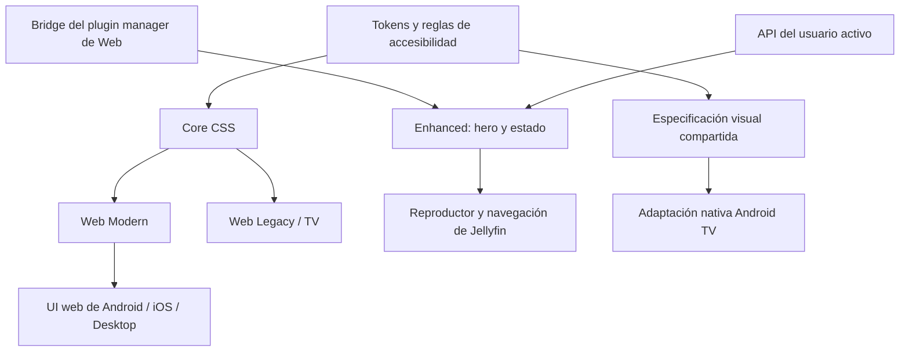

# Arquitectura JellyTV

## Revisión web 1.1 en desarrollo

Core conserva módulos compartidos y añade `home.css` para densidad/rails y `compat/details-legacy.css` para el contrato10.10.6. Este perfil exige que primaryContainer sea también detailRibbon; el perfil posterior exige la estructura distinta. No selecciona geometría por la versión de Server a ciegas. Logo y póster son elementos con espacio propio; el logo en flujo reserva altura/gap, mientras Primary conserva la proporción nativa.

Enhanced comparte `model.mjs` (roles y metadata), `adapter.mjs` (sesión/API/navegación/player), `hero.mjs` y `preview.mjs`. Un canal EventTarget del adaptador comunica confirmaciones de UserData entre hero/preview, identificado por servidor+usuario. No escribe storage ni manipula cards nativas. Preview mantiene un portal, caché acotada24elementos, petición tras intención y cleanup por AbortController. El inspector en `scripts/debug` no entra en bundles. La validación completa de esta arquitectura en10.10.6 sigue [abierta](ACCEPTANCE_VNEXT.md).

## Arquitectura histórica 1.0.0

Decisión del 14 de octubre de 2026, basada en [RESEARCH.md](RESEARCH.md). Implementación 1.0.0; los resultados de ejecución están separados en [TESTING.md](TESTING.md).

## Capas y distribución

Core se compila como una única hoja autocontenida, con tokens configurables al final de Custom CSS. Enhanced se distribuye como bundle local y hoja independiente; no descarga código desde `latest`. El instalador valida webroot/config, respalda los originales y registra hashes. Eliminar la referencia y restaurar config revierte Enhanced sin reinstalar servidor. La administración mantiene su estructura.

## Organización

| Directorio | Responsabilidad |
|---|---|
| `theme/` | tokens, base, componentes, animación, Modern/Legacy, tablet, móvil, TV y accesibilidad |
| `enhanced/` | modelo de datos, adaptador web, hero, navegación y lifecycle |
| `scripts/` | build, validación e instalación/rollback local explícito |
| `tests/` | unidades, contratos y E2E contra Jellyfin real |
| `android-tv/` | adaptación sobre cliente nativo fijado, instrucciones y resultados propios |
| `dist/` | artefactos reproducibles y manifiesto de checksums |
| `docs/` | investigación, instalación, compatibilidad y evidencias |
| `.lab/` | servidor/medios/credenciales de prueba locales, excluidos de distribución |

No se crea un cliente móvil nuevo: los wrappers reutilizan el núcleo web. Swiftfin no carga ese núcleo; cualquier trabajo nativo suyo debe conservar una matriz independiente.

## Sistema visual

Tokens implementados; el contraste compuesto sobre artwork se comprueba aparte:

| Token | Base propuesta |
|---|---|
| `--color-background` | `#080a0e` |
| `--color-surface` | `#15191f` |
| `--color-surface-elevated` | `#242a33` |
| `--color-text-primary` | `#f5f7fa` |
| `--color-text-secondary` | `#b6bdc7` |
| `--color-text-muted` | `#9ba5b3` |
| `--color-accent` | `#d8eaff` |
| `--color-focus` | `#c5e7ff` |
| `--radius-small/medium/large` | 8 / 14 / 22px, expresados en rem |
| `--spacing-*` | escala 4 / 8 / 12 / 16 / 24 / 32 / 48 / 64px |
| `--transition-fast/normal/slow` | 120 / 200 / 360ms |
| `--blur-*` | 0 / 12 / 20px, únicamente superficies pequeñas |
| `--shadow-*` | elevación de tarjetas, diálogo y foco |
| `--card-size`, `--density`, `--hero-height` | controles independientes por layout |

Fuente del sistema: `system-ui`, Segoe UI, Roboto, sans-serif; ninguna fuente remota obligatoria. Los cálculos sólidos iniciales dan 18.46:1 para texto primario/fondo y 9.32:1 para secundario/surface. No certifican el contraste sobre una imagen.

Las tarjetas conservan proporción apropiada: paisaje para episodios/Continue Watching, poster para películas, cuadrado para álbumes. Hover solo con puntero fino; focus siempre visible también sin hover. Pressed reduce ligeramente la escala. Disabled conserva significado y estado accesible. El estado seleccionado utiliza borde/marca además de color. Loading no cambia el tamaño reservado.

## Integración web y mantenimiento

Core cubre tanto componentes compartidos `emby-*` como clases estables de slots MUI. Los selectores se registran contra el tag objetivo y se comprueba presencia real. No usar `nth-child` para identificar acciones ni ocultar texto o controles globalmente. `!important` solo para vencer un estilo upstream comprobado y con comentario de causa.

Enhanced utiliza el plugin manager de Web para recibir reproducción, navegación y conexión activa. Registrar el bootstrap antes de que se resuelva `config.json.plugins` es parte del contrato de instalación. No se inspecciona el almacenamiento de credenciales ni módulos privados del bundle. La integración sigue siendo interna y versionada, por lo que se comprueban capacidades antes del montaje.

Las peticiones HTTP reutilizan Client, Device, DeviceId y Version del cliente autenticado, además de su token; no inventan otra identidad de sesión en el servidor. Los valores se validan antes de construir el encabezado y no se guardan en almacenamiento propio.

Un único host del hero por Home activa. La ruta monta/desmonta; si la Home llega después, se admite observación temporal de inserciones en su contenedor, desconectada una vez encontrada. No se observan atributos de todo el documento. Un cambio de sesión invalida resultados, solicitudes y cache antes de pintar otro usuario.

## Datos y acciones del hero

Los candidatos provienen de la biblioteca accesible al usuario. Máximo: 6 elementos por Home, campos necesarios, backdrop y logo si existen. Sin catálogo vacío inventado ni datos de demostración en el bundle. Una biblioteca sin candidatos mantiene la Home original y un fallo de red no deja overlay interceptando eventos.

Cada candidato contiene ID, tipo, título, año, clasificación, puntuación, géneros, descripción, imagen y datos de usuario. Si falta artwork se muestra gradiente neutral. El logo no sustituye el nombre accesible. Los textos se insertan como texto, no HTML de metadata. Se dimensionan imágenes con el servicio de Jellyfin y se carga únicamente el slide elegido; dos imágenes permiten el crossfade.

Play/Resume delega al reproductor nativo del web. Para series se resuelve un episodio reproducible; no se presenta Play activo para una carpeta sin reproducción. Info abre el detalle mediante router del cliente. Favoritos persiste con la sesión activa y revierte visualmente en error. Progreso se deriva de ticks/estado real y no se actualiza por un timer ficticio. Recomendaciones usan lo disponible en Jellyfin, sin inventar un ranking de popularidad.

Esta versión no añade reproducción de trailers al hero. Las acciones nativas disponibles en la ficha permanecen en Jellyfin; no se carga YouTube u otros terceros para decorar.

## Interacción y responsive

Desktop: texto limitado por ancho legible, hero amplio y fila inmediata debajo. Móvil de 320px en adelante: acciones que envuelven, safe areas, metadata corta, scroll vertical libre y swipe horizontal que respeta desplazamiento vertical. Tablet conserva más artwork y densidad intermedia. Zoom y landscape no deben ocultar Close/Play.

TV se activa por modo de layout, no por ancho de pantalla. Márgenes de seguridad y tipografía/targets mayores; foco con borde y sombra, crecimiento moderado sin recorte por la fila. ArrowDown sale del hero hacia la Home, ArrowUp permite regresar, Back mantiene semántica upstream y se restaura el elemento enfocado al volver del detalle. No reemplazar todos los key handlers del cliente.

Carrusel: manual por defecto; rotación opcional con pausa/reanudar explícito, parada al foco, hover, touch, documento oculto, reproducción y reduced motion. Después de foco/interacción no reinicia sin petición del usuario. Los botones permanecen estables al cambiar de slide. El slide oculto no conserva controles tabulables. Tab/Shift+Tab siguen la navegación normal.

## Rendimiento y limpieza

Core no añade solicitudes API. Presupuestos de Enhanced: bundle ≤60KiB gzip, CSS total ≤35KiB gzip; un lote acotado de candidatos y ningún polling permanente. Los tamaños actuales están en [manifest](../dist/manifest.json) y la medición comparativa en [performance.json](validation/performance.json). Cache en memoria de corta duración con clave servidor/usuario; nunca tokens en logs, manifests o screenshots. Toda operación asíncrona valida generación de sesión antes de aplicar resultados. Timers, observers, listeners y solicitudes se liberan al desmontar.

Fallback sin `backdrop-filter`: surface opaca. Reduced motion: sin escala animada, rotación automática ni transiciones extensas. Focus visible no depende de blur/glow. Las capas de arte no reciben eventos de puntero.

## Android TV nativo

La línea estable investigada es 0.19.10, que combina Compose y Leanback. La adaptación necesita tokens nativos y cambios en tarjetas/presentadores/home/focus; un archivo CSS no alcanza estas superficies. Se mantendrá reproducción upstream y un identificador/firma de aplicación diferenciados cuando se produzca APK. No se distribuirá como actualización oficial del cliente Jellyfin.

No se reescribe el cliente completo. Los cambios deben poder aplicarse/revertirse sobre un tag exacto y conservar licencias upstream. Gradle, lint y tests de foco son requisitos separados; la falta de emulador o dispositivo produce UNVERIFIED, no PASS.

## Release

Durante desarrollo: 0.x. Solo 1.0.0 cuando [TESTING.md](TESTING.md) y la matriz correspondiente estén satisfechos. El informe final debe separar funcionalidades implementadas, pruebas efectivamente ejecutadas y plataformas pendientes; no basta un build exitoso.

## Corrección acotada del anfitrión

La validación de Quick Connect detectó un rechazo `undefined` al cerrar su diálogo en Web 12.2 original. `web-compat/` entrega un parche del call-site y fuentes completas; `scripts/fix-quick-connect.mjs` aplica/revierte únicamente el bundle con el SHA previsto. No añade lógica a Core, no sustituye autenticación y no instala un filtro global de promesas. Tiene su propio respaldo y ciclo de retirada, separado del instalador Enhanced. La autenticación se repite con el mismo arreglo en baseline, Core y Enhanced.

La validación final detectó además que `ViewManagerPage` podía terminar una importación después de Back y superponer la ficha a Inicio. El segundo parche usa el flag `cancel` que ya entiende ViewManager, activándolo desde el cleanup de React. Los seis controles con latencia y el lifecycle original pasan sin cambiar sus acciones. Las comparaciones y las pruebas finales identifican por SHA ambos arreglos del anfitrión.
